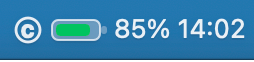
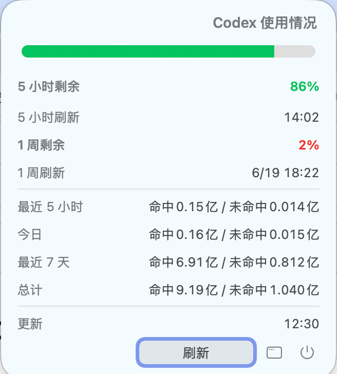
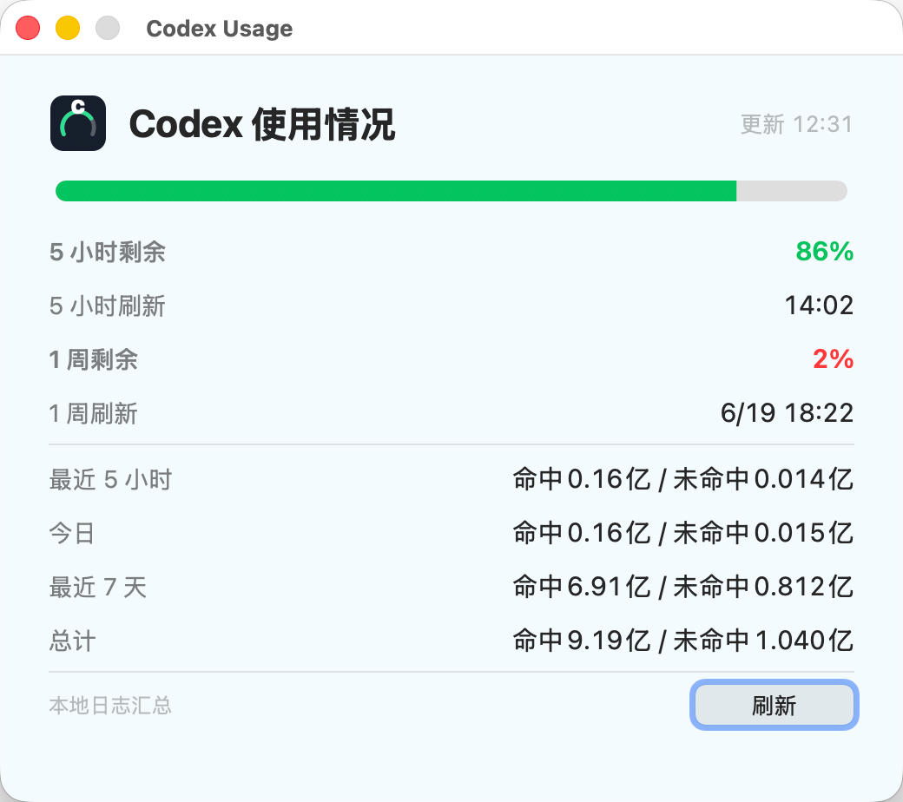

# Codex Usage Monitor for macOS

一个本地 macOS 菜单栏工具，用来查看 Codex 使用情况和剩余额度。

当前主功能是菜单栏常驻显示，例如：

```text
[Codex 标识 + 彩色电量条] 64% 14:02
```

点击菜单栏项目后可以查看：

- 按账号实际返回的窗口显示剩余额度和重置时间（支持只有 7 天主窗口的账号）
- 额度快照时间与本地采集时间分别显示
- 当 7 天窗口更接近限制时，菜单栏会优先显示周剩余额度和周刷新时间
- 最近 5 小时、今天、最近 7 天、累计本机日志 token 统计，并区分命中缓存和未命中缓存
- 紧凑的彩色进度条，颜色随剩余额度变化

## 效果图

菜单栏常驻状态：



| 菜单栏展开面板 | 主窗口 |
| --- | --- |
|  |  |

## 可选磁盘监测

在主窗口或 Codex 菜单栏展开面板勾选 **在菜单栏显示磁盘剩余空间**。此选项默认关闭，并记住选择。

- 只有启用后才创建独立磁盘菜单栏图标、读取容量和启动 60 秒监测定时器。
- 取消勾选或点击磁盘菜单中的“关闭磁盘监测”会移除图标、取消定时器、清空内存读数；尚未完成的读取结果会被丢弃。
- 默认监测当前用户主目录所在的系统数据卷。显示总容量、可用空间、使用比例估算和读取时间。
- 可用容量优先采用 macOS 的重要资源可用容量（可包含可清理空间），与纯空闲容量可能不同；不遍历或读取个人文件。
- 可用空间不超过 10 GB 或 10% 时为橙色，不超过 5 GB 或 5% 时为红色。

## 数据过期提醒

- Codex **额度快照**超过 3 分钟，菜单栏加 `⚠︎` 并显示橙色提醒。读取旧日志成功不会刷新额度快照的时间；未使用 Codex 时也可能出现此提示。
- 采集时间超过 3 分钟或采集报错时也会提醒。悬停和展开面板说明旧读数的原因。
- 磁盘最近成功读取超过 3 分钟或读取失败时显示 `⚠︎`，保留上次读数供参考；新数据成功读取后自动恢复。
- 独立的轻量检查每 15 秒更新提醒（允许 2 秒容差），不读磁盘或写日志；睡眠期间不运行，唤醒后立即检查和刷新。

## 安静运行

应用不会逐分钟追加运行日志。LaunchAgent 的标准输出和错误输出均指向 `/dev/null`，错误在界面内显示。磁盘读数仅驻留内存；Codex 摘要仍是固定大小 JSON 文件的原子覆盖，不是追加日志。`--collect --print` 只用于手动诊断。

## 数据来源

工具只读取本机 Codex 日志：

```text
~/.codex/sessions/**/*.jsonl
~/.codex/archived_sessions/**/*.jsonl
```

设置了 `CODEX_HOME` 时使用该目录；安装时会把该设置传递给登录启动任务。

不会读取 `~/.codex/auth.json`，也不会上传任何 Codex 日志、token 或磁盘数据。

## 安装

在项目目录执行：

```sh
./Scripts/install.sh
```

安装脚本会：

- 只构建原生 Objective-C/AppKit 菜单栏程序（使用本机 CPU 架构）
- 优先安装到 `/Applications/Codex Usage.app`，无写权限时安装到 `~/Applications`
- 使用仓库中的图标，完成本地签名验证
- 注册一个登录启动任务并启动菜单栏常驻项
- 升级时保留旧 App 供恢复

安装后只创建一个 LaunchAgent：

```text
~/Library/LaunchAgents/com.gukai.CodexUsage.menubar.plist
```

菜单栏进程每 60 秒刷新一次（允许 10 秒定时容差，唤醒后也会刷新），并写入：

```text
~/Library/Application Support/CodexUsage/usage_summary.json
```

## 手动刷新

点击菜单栏项目展开面板，然后点击：

```text
刷新
```

## 打开主窗口

从展开面板点击窗口图标，或直接打开：

```text
/Applications/Codex Usage.app
```

主窗口使用和展开面板一致的 dashboard 设计，适合停靠查看。

## 卸载

```sh
./Scripts/uninstall.sh
```

保留本地 `usage_summary.json` 等支持数据：

```sh
./Scripts/uninstall.sh --keep-data
```

## 重装

```sh
./Scripts/reinstall.sh
```

## 构建

当前安装包使用 Objective-C/AppKit 作为菜单栏主体：

```sh
./Scripts/build-objc.sh
./Scripts/install.sh
```

Swift/WidgetKit 源码保留在：

```text
Sources/CodexUsageCore
Sources/CodexUsageWidgets
Sources/CodexUsageMenuBar
```

小组件和 Swift 源码作为实验版本保留，不参与当前安装；本文描述的优化和测试针对 Objective-C 菜单栏版本。

## GitCode 来源

本机工作副本直接克隆自：

```text
origin https://gitcode.com/jumpgu/codex-usage-monitor.git
```

安装不需要 GitCode 令牌；凭据不会写入 App、LaunchAgent 或仓库配置。

## 本机优化与验证

- 使用 `window_minutes` 生成窗口标题；没有第二窗口时不显示空的周额度行。
- 额度重置过期后显示未知值，保留真实观察时间，等待新的 Codex 日志；不推算服务端重置时间。
- 内存缓存未变化文件中的 token 事件，文件大小、修改时间或文件编号变化后重新解析；删除文件会清理缓存。
- 以累计 token 数识别同一文件内重复的 token 通知，避免把重复通知再次累计。
- 跳过损坏行与尚未写完的末行；不缓存对话正文，也不写入额外日志副本。
- 取消独立的周期采集进程，避免与菜单栏进程重复扫描；不安装实验小组件或重启系统小组件服务。

验证：

```sh
./Scripts/test.sh
./Scripts/install.sh
```

测试涵盖开关保存、默认关闭不读取、关闭定时器、丢弃过期异步结果、读取失败、180 秒时效边界、真实磁盘容量，以及单周窗口、到期额度、旧格式、重复事件、缓存失效、未完成及损坏 JSON 行、删除文件。

## 数据含义与限制

- 菜单栏百分比为**剩余额度**。本机日志中的额度快照可能早于其他设备上的使用情况，点击“刷新”仅重新读取本机日志，不主动查询账号服务器。
- Codex 需要先写入包含额度的 `token_count` 事件，工具才能更新额度快照。
- token 数为本机日志估计，不代表账单或账号配额；复制、分叉或恢复日志可能影响累计统计。
- 实验 Swift/WidgetKit 实现未纳入本次修正与验证。
